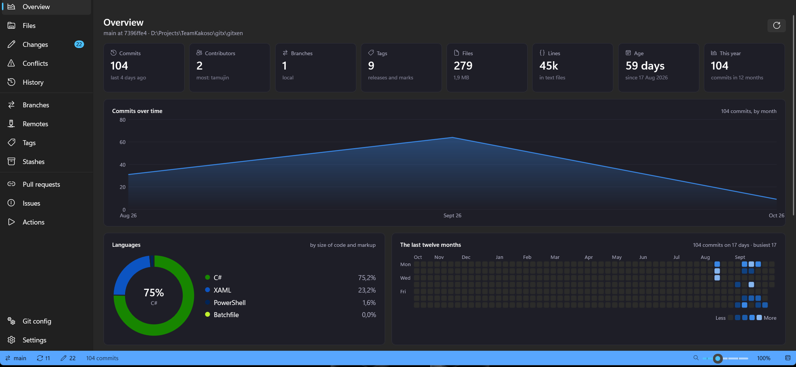

# Gitxen

[](https://github.com/KakosoAi/gitxen/actions/workflows/ci.yml)
[](https://github.com/KakosoAi/gitxen/releases)
[](LICENSE)


Gitxen is a git client for Windows, built with WinUI 3.



It shows staged and unstaged changes with hunk-level staging, a commit graph with ref badges and
live search, branches, remotes, tags, stashes, submodules, worktrees, reflog recovery and conflict
resolution — with several repositories open at once as tabs.

Gitxen is free software under the [GNU GPL v3 or later](LICENSE), © 2026 Kakoso. It is in public
beta: it works and is used daily, and it still changes quickly.

## Highlights

* **Fast, honest git:** it runs the `git` you have installed, so what you see is what git did; press
  F12 to watch every command.
* **Stage by hunk,** visual interactive rebase, reflog recovery and conflict resolution.
* **Search every repository** you have opened from one box (Ctrl+K), by message, author or content.
* **Safety nets:** warns before committing secrets or huge files, and can undo the last operation.
* **GitHub built in:** pull requests, issues and Actions, with one account per repository.
* **`gx` command line** for scripting, account switching and starting new repositories.
* **No telemetry**, and no sign-in of its own.

## Status

Gitxen is in beta (current version: 0.10.1). The WinUI 3 front-end lives in
[src/app/Gitxen/](src/app/Gitxen/). It runs the installed `git` as a
subprocess through its own small layer, [src/app/Gitxen.Git/](src/app/Gitxen.Git/), and no longer
links any Git Extensions code. The original WinForms application and the engine it shared were
removed from this repository.

For repositories on github.com it also shows pull requests, issues and Actions runs, through the
[GitHub CLI](https://cli.github.com) (`gh`) when that is installed and signed in. It is a separate
program and keeps the sign-in; Gitxen stores no token. With several accounts signed in to gh, each
repository is read as the one that can see it, or the one chosen for it. The section can be switched
off in Settings.

## Install

Requires Windows 10 (1809) or later, x64. Packages are self-contained — no separate .NET or
Windows App SDK install is needed.

* **Installer (MSI)** or **portable zip**: download from the
  [releases page](https://github.com/KakosoAi/gitxen/releases).
* **PowerShell one-liner** (per-user, no admin, verifies checksums):

  ```powershell
  irm https://raw.githubusercontent.com/KakosoAi/gitxen/main/setup/gitxen/install.ps1 | iex
  ```

* **Package managers**, as the channels come online: winget (`Kakoso.Gitxen`),
  Chocolatey (`gitxen`), Scoop (`gitxen`).

Every channel puts `gitxen` on `PATH` and adds a Start menu entry. Packaging details live in
[setup/gitxen/](setup/gitxen/README.md).

## Building from source

Requires the [.NET 10 SDK](https://dotnet.microsoft.com/download/dotnet/10.0) (pinned in
`global.json`), a Windows SDK install, and Visual Studio 2026 for the full solution. After cloning:

```
dotnet build Gitxen.slnx
dotnet build src/app/Gitxen/Gitxen.csproj -c Debug -p:Platform=x64
```

`Gitxen.slnx` is the whole repository: the application, `Gitxen.Git` (the layer that runs git) and
`Gitxen.GitHub` (the layer that runs the GitHub CLI). See the
[Gitxen README](src/app/Gitxen/README.md) for the project layout and conventions.

## Licence

Gitxen is free software, © 2026 Kakoso, licensed under the **GNU General Public License,
version 3 or (at your option) any later version** — see [LICENSE](LICENSE).

* You may use it for any purpose, study it, change it and share it.
* If you distribute it, modified or not, you must do so under the same licence and make the
  corresponding source available. That is what stops it being closed up and resold.
* The name and logo are not covered by the licence — see [TRADEMARK.md](TRADEMARK.md).
* Need to ship it inside a closed product? See [COMMERCIAL.md](COMMERCIAL.md).

Gitxen runs `git` as a separate program; git is not bundled with it and carries its own licence.
[NOTICE.md](NOTICE.md) lists the components Gitxen does include, and records the project's history:
Gitxen began as a fork of [Git Extensions](https://github.com/gitextensions/gitextensions) and ran on
that project's engine up to version 0.2.0, which was released under GPL-3.0. That engine has since
been replaced and no Git Extensions code remains. Gitxen is not endorsed by or affiliated with that
project.

## Links

* Issue tracker: [github.com/KakosoAi/gitxen/issues](https://github.com/KakosoAi/gitxen/issues)
* Documentation: [docs/](docs/README.md) · [Changelog](CHANGELOG.md) · [Roadmap](ROADMAP.md)
* Contributing: [CONTRIBUTING.md](CONTRIBUTING.md) · Security: [SECURITY.md](SECURITY.md) ·
  Conduct: [CODE_OF_CONDUCT.md](CODE_OF_CONDUCT.md)
